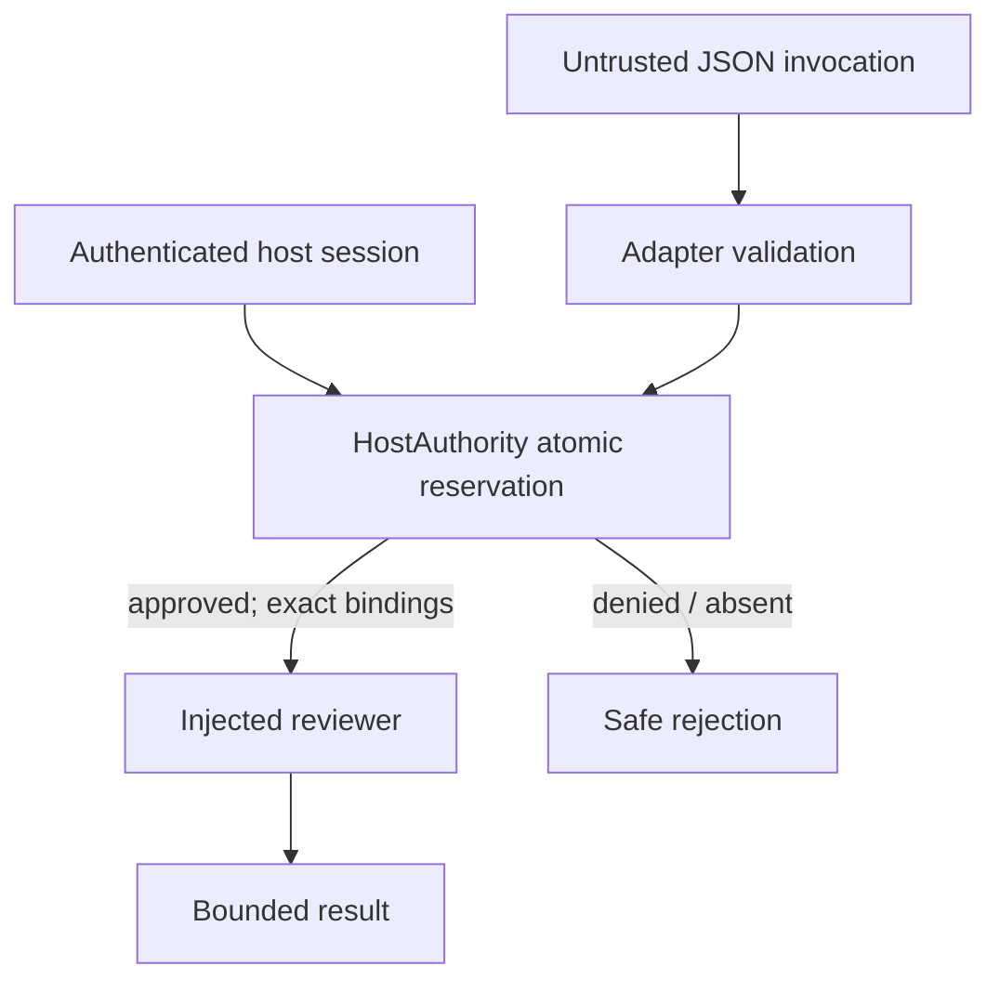

# Aeonith conditional host authority boundary (prototype)

Status: **source-level prototype, not a live host integration or security attestation**.

This package imports the current Aeonith `capability_adapter.py` and provides
`invoke_with_host_authority()`. It authorizes only `aeonith.review.v1`, with
effect `read_only_review`. No manuscript, memory, canonical-text, deployment,
mailbox or repository write permission is derived from a critique.

## Trust boundary

The caller's JSON envelope is **only correlation and payload data**, not an
authorization token. Client-supplied `lease`, `authorization`, `provider`, or
`consent` fields are rejected as extra envelope keys. `request_id` is not an
anti-replay nonce by itself; the host must durably deduplicate the passed
`request_id` as well as the request digest and reservation identifier. The
host must supply `HostContext` from its authenticated
transport and inject the provider after it independently binds the provider
destination, endpoint and credential store. Do not accept a caller's
`HostContext`, `HostAuthority`, `reviewer` or `clock` over a public API.

The Python dataclasses and Protocol are **not** signed attestations. A process
that allows a malicious caller to provide their own authority callback can be
fooled. This module cannot distinguish genuine and forged Python objects.
The deployment must enforce the host/trust boundary outside the caller's
process (transport identity, host-held credentials, unforgeable session, code
ownership and endpoint policy). Default when any host authority is absent:
**deny**.

## Reservation contract

Before returning a committed `Reservation`, a host implementation must make
one atomic, durable decision to:

1. Authenticate `actor_id` and tenant scope; authorize capability and read-only
   effect; bind the validated `request_id`, the host-derived
   `external_provider` classification and the exact SHA-256 digest of
   original request bytes. Two different payloads reusing the same invocation
   ID must not spend two grants.
2. Resolve actual provider destination and external/internal disclosure state
   independently of user input. If external, require active **explicit consent**
   for the named provider and the full payload/disclosure scope; return a
   host-held consent receipt identifier. Record consent revocation/version,
   exact data scope and timestamp outside this prototype.
3. Check lease issuer, grant scope and expiry using trusted host time. Reserve
   exactly one provider call and the input/output quota prior to dispatch.
4. Atomically reject replay or duplicate spending of invocation/reservation
   identifiers across all workers, restarts and retries, or return a durable
   idempotent cached outcome instead of re-executing. A local Python `set` is
   not sufficient. Snapshots/rollback must not reset this ledger.
5. Enforce the reserved input/output token, cost, duration and cancellation
   budgets at provider dispatch; refuse an actual provider configuration that
   cannot enforce the host quota or trusted endpoint policy. Enforce rate
   ceilings as a separate host control.
   A post-hoc output byte check cannot constrain billable
   model tokens, external data disclosure, wall time or resource use.

The adapter validates a maximum 256 KiB invocation and 2 MiB reviewer output.
Before consuming a grant, the gate also validates the underlying review
request offline with the core and requires the expected unconfigured-provider
status. No model request is sent during preflight.
This gate additionally binds each input digest and enforces lease byte caps,
one reserved provider call, lease validity and a serialized result byte cap.
No reviewer is created or network client contacted by the gate itself. A
reservation may be consumed even if the provider later fails; refund/settlement
is host-owned. The gate does not promise retry safety.

## Fresh source contracts consulted (2026-10-31, `main`)

| Source | Commit | Relevant boundary |
|---|---|---|
| `thebrazenbeard/aeonith` | `63f10ff049ddc33359a7960bc06b1f8c645880ba` | `capability_adapter.py`: correlation-only envelope; host owns authorization, consent, provider identity, budgets |
| `thebrazenbeard/rezon` | `cdd36d0df2a6194dd2738fb29ee8931933bcef7b` | `docs/contracts/REASONING_NODE_V0.md`: DESIGN reasoning nodes and receipts; scheduling is not a grant |
| `thebrazenbeard/ccb-core` | `57b5bb97b923e43da0fb677b4e4a907bab222e37` | Public source, but identity, private overlays, deployment trust anchors external |
| `thebrazenbeard/chat-communication-bus` | `eb315a5612ae99aadddb397891ffcf3a2b0433a6` | Public coordination, not a private authenticated runtime/mailbox |
| `thebrazenbeard/unbound-sol` | `1749586848429f845ace22b2b0fa84d9e7a0ddf0` | Excludes credentials, private transcripts and private environment maps |

Nothing here grants an actual CCB/Rezon capability, proves an operational
deployment, or authorizes publication. Any production integration needs a
separately audited host implementation, private ledger and explicit provider
disclosure UX. Its security and replay claims must be independently tested
against worker concurrency, process restart, rollback, hostile request input,
consent withdrawal and quota exhaustion.
